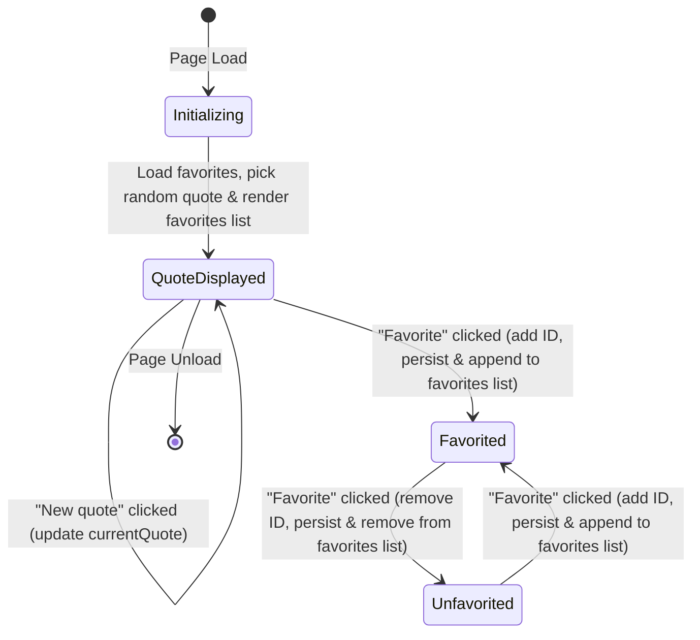

# Data Model: Quote of the Day

**Feature**: [Quote of the Day Specification](spec.md)  
**Date**: 2026-10-12 (Updated: 2026-10-12)  
**Status**: Ready  

---

## 1. Entities & Data Schemas

### `Quote`
Represents an inspirational quotation in the built-in catalog.

| Field | Type | Description | Constraints |
|---|---|---|---|
| `id` | `string` | Unique identifier (e.g. `"q1"`, `"q2"`) | Non-empty, unique across catalog |
| `text` | `string` | The quote body | Non-empty text |
| `author` | `string` | The person credited with the quote | Non-empty text |

### `FavoriteStore`
Represents the persistent record of user-favorited quotes stored in browser `localStorage`.

| Field | Type | Description | Constraints |
|---|---|---|---|
| `storageKey` | `string` | Key used in `localStorage` | Constant: `"quote_app_favorites"` |
| `favoriteIds` | `string[]` | Array of quote IDs marked as favorites | Must contain only valid string IDs |

### `AppState`
Represents runtime client-side state in the application.

| Field | Type | Description |
|---|---|---|
| `quotes` | `Quote[]` | Immutable array of built-in quote items ($N \ge 5$) |
| `currentQuote` | `Quote` | The quote currently rendered in the active quote card |
| `favorites` | `Set<string>` | Active set of favorited quote IDs |
| `storageAvailable` | `boolean` | Flag reflecting whether browser persistence is functional |

### `FavoritesListView` (UI Entity)
Represents the rendered list of favorited quotes presented in `#favorites-section`.

| Field | Type | Description |
|---|---|---|
| `items` | `Quote[]` | Derived list: `{quote in quotes | favorites.has(quote.id)}` |
| `isEmpty` | `boolean` | `true` when `items.length === 0`; controls display of `#favorites-empty` |

---

## 2. Validation Rules

- **Catalog Validation**: Built-in quotes catalog MUST contain at least 5 quotes. Each quote MUST have a unique `id`, non-empty `text`, and non-empty `author`.
- **Storage Deserialization**: Stored data parsed from `localStorage` MUST be verified to be an array of strings. If deserialization fails (invalid JSON or non-array), the store resets to an empty array without crashing.
- **Storage Serialization**: Serialized data MUST be written as valid JSON stringified array. Storage operations MUST be wrapped in a `try...catch` block.
- **Favorites List Integrity**: The rendered favorites list MUST display only quotes whose IDs exist in the active `AppState.favorites` set. Items in the list MUST render both `text` and `author`.

---

## 3. State Transitions

### Transition Specifications:

1. **`INITIALIZE`**:
   - Read `localStorage.getItem("quote_app_favorites")`.
   - Parse into `favorites` (`Set<string>`). If read/parse fails, initialize empty `Set` and set `storageAvailable = false`.
   - Choose a random quote from `quotes`.
   - Update active quote card in UI (`#quote-text`, `#quote-author`, and favorite toggle state).
   - Render `#favorites-list` from `favorites`: if empty, display `#favorites-empty`; otherwise render each favorited quote's text and author into `<ul id="favorites-list">`.

2. **`CYCLE_QUOTE`**:
   - Filter `quotes` where `quote.id !== currentQuote.id`.
   - Select uniformly from remaining quotes.
   - Set `currentQuote = selectedQuote`.
   - Update active quote card UI and toggle state.

3. **`TOGGLE_FAVORITE`**:
   - If `favorites.has(currentQuote.id)`:
     - Delete `currentQuote.id` from `favorites`.
   - Else:
     - Add `currentQuote.id` to `favorites`.
   - If `storageAvailable`:
     - Write JSON-serialized array of IDs to `localStorage`.
   - Update favorite button visual appearance, label, and `aria-pressed`.
   - Re-render `#favorites-list` and `#favorites-empty` immediately.
